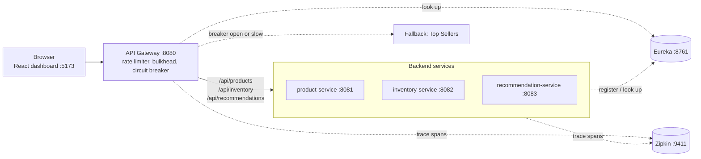
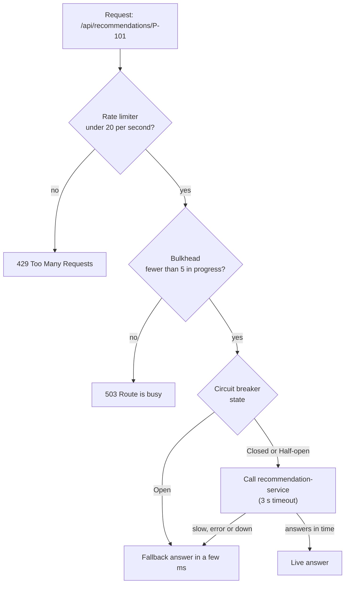
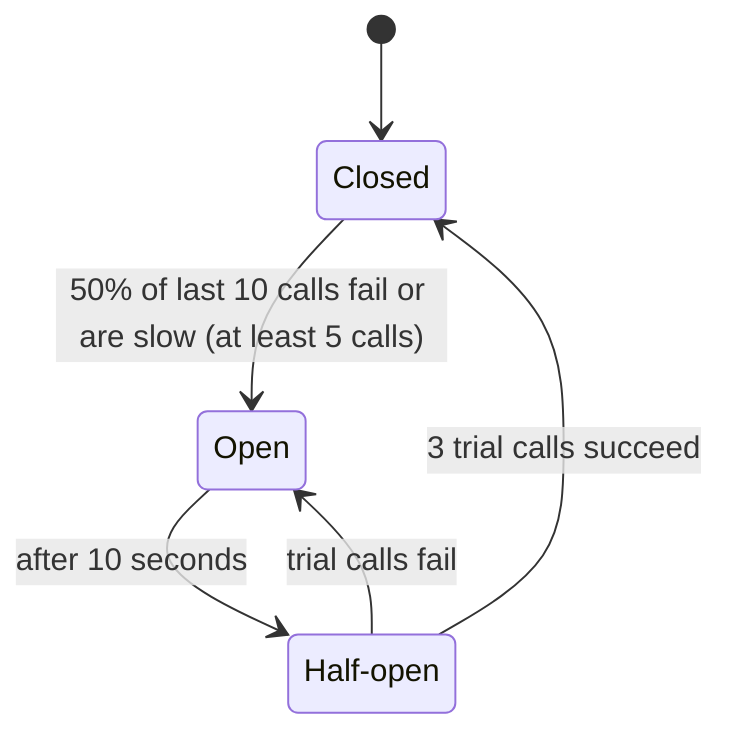

# CircuitBreaker: Resilient API Gateway for an E-Commerce Platform

A Spring Cloud microservices system that keeps an online shop working when one of its services slows down or fails. A single API Gateway sits in front of every service and protects the shop with a **circuit breaker**, a **rate limiter** and a **bulkhead**. A React dashboard shows what is happening live, and **Zipkin** traces every request across services.

Built for the Axlero Solutions Java Full Stack internship, Project 3.

| | |
|---|---|
| **Stack** | Java 17, Spring Boot 3.2.5, Spring Cloud 2023.0.1, Resilience4j, Eureka, Micrometer Tracing, Zipkin, React 18, Vite 5 |
| **Status** | Weeks 1 to 4 complete. 16 of 16 test cases pass ([test report](docs/TEST-REPORT.md)) |

---

## Contents

1. [The problem](#1-the-problem)
2. [The solution](#2-the-solution)
3. [Architecture](#3-architecture)
4. [Quick start](#4-quick-start)
5. [The dashboard](#5-the-dashboard)
6. [Resilience settings](#6-resilience-settings)
7. [API reference](#7-api-reference)
8. [Distributed tracing](#8-distributed-tracing)
9. [Demo script](#9-demo-script)
10. [Testing](#10-testing)
11. [Project structure](#11-project-structure)
12. [Troubleshooting](#12-troubleshooting)
13. [Known limitations](#13-known-limitations)
14. [Team](#14-team)

---

## 1. The problem

On a busy sale day, the Recommendation Engine of an online shop becomes slow or crashes. Every service waiting for it starts to hang, threads pile up, and soon product pages, stock checks and checkout slow down too. One weak service drags the whole shop down.

## 2. The solution

All traffic goes through one API Gateway. The gateway notices when a service is struggling and protects the rest of the system:

| Pattern | What it does | What the shopper sees |
|---|---|---|
| **Circuit breaker** | After too many slow or failed calls, stops calling the Recommendation service for a while and answers at once with a safe fallback | "Top Sellers" instead of a hanging page |
| **Rate limiter** | Allows 20 requests per second per client, rejects the rest with `429` | One abusive client cannot flood the gateway |
| **Bulkhead** | Allows only 5 concurrent calls to the recommendation route, rejects extra calls with `503` | A slow service cannot use up every thread |
| **Service discovery** | The gateway finds services by name in Eureka, with no hard-coded host or port | Services can move without changing the gateway |
| **Tracing** | One trace id follows a request through the gateway and every service | Easy to see where time is spent |

The rest of the shop (products, stock) stays fast the whole time.

## 3. Architecture



### What happens to a recommendation request



### Circuit breaker states



### Services

| Module | Port | Role |
|---|---|---|
| `eureka-server` | 8761 | Service registry. Every service registers here at startup |
| `product-service` | 8081 | Product catalogue |
| `inventory-service` | 8082 | Stock level per product |
| `recommendation-service` | 8083 | "You may also like" answers. Has a **chaos switch** (normal, slow, fail) so we can break it on purpose |
| `api-gateway` | 8080 | Single entry point with all the protection |
| `dashboard` | 5173 | React monitoring and chaos console |

## 4. Quick start

### Requirements

- Java 17 or newer
- Maven 3.9 or newer (or run the `*Application` classes from IntelliJ)
- Node.js 18 or newer (for the dashboard)
- Zipkin jar (optional, for tracing): download from https://zipkin.io/pages/quickstart

### Start the backend (in this order)

Eureka must be up first, the gateway last. Run each in its own terminal, from the repository root.

```bash
cd circuitbreaker-gateway/eureka-server          && mvn spring-boot:run   # 1
cd circuitbreaker-gateway/product-service        && mvn spring-boot:run   # 2
cd circuitbreaker-gateway/inventory-service      && mvn spring-boot:run   # 3
cd circuitbreaker-gateway/recommendation-service && mvn spring-boot:run   # 4
cd circuitbreaker-gateway/api-gateway            && mvn spring-boot:run   # 5
```

### Start the dashboard

```bash
cd circuitbreaker-gateway/dashboard
npm install
npm run dev          # http://localhost:5173
```

The dashboard talks to `http://localhost:8080`. To use another gateway address, set `VITE_API_BASE`.

### Start Zipkin (optional)

```bash
java -jar zipkin.jar          # http://localhost:9411
```

The services run fine without Zipkin. They only log a harmless "connection refused" warning when they try to send traces.

### Check that it works

| Check | Expected |
|---|---|
| http://localhost:8761 | PRODUCT-SERVICE, INVENTORY-SERVICE, RECOMMENDATION-SERVICE and API-GATEWAY all **UP** |
| http://localhost:8080/api/products | Product list (served by product-service, called through the gateway) |
| http://localhost:8080/api/inventory | Stock list |
| http://localhost:8080/api/recommendations/P-101 | Recommendations for product P-101 |
| http://localhost:8080/actuator/gateway/routes | The routes the gateway knows |
| http://localhost:5173 | Dashboard, "All services healthy" |

If `/api/products` works on port **8080** and you never call port 8081 yourself, that proves routing through service discovery.

## 5. The dashboard

The dashboard is built for people who do not read logs. It uses plain words, updates every 3 seconds, and has light, dark and automatic themes.

| Section | What it shows |
|---|---|
| **Headline** | One sentence: "All services healthy" or "Breaker is open, shoppers see Top Sellers" |
| **Breaker panel** | One lever per service. Up is healthy, middle is testing, down is stopped or failing |
| **What protects the shop** | Four cards: circuit breaker (state, failure rate), rate limiter (limit, blocked count, test button), bulkhead (limit, in use, rejected) and request tracing (opens Zipkin) |
| **Break something on purpose** | Chaos controls: Normal, Slow (4 s), Fail (500), Trigger latency, Send 12 at once, Back to normal, and an optional automatic request every 2.5 s |
| **Live requests** | Newest first, each marked Live or Backup with its response time, plus Live, Backup, Blocked and Error counters |
| **What happened** | A timeline of chaos changes and breaker changes (Open, Half-open, Closed) with times |
| **What the shopper sees** | A small storefront with products, stock and recommendations that keeps working while the breaker is open |

## 6. Resilience settings

| Setting | Value | Where |
|---|---|---|
| Breaker window | last 10 calls, minimum 5 | `ResilienceConfig.java` |
| Opens when | 50% of calls fail, or 50% take longer than 2 s | `ResilienceConfig.java` |
| Timeout per call | 3 s | `ResilienceConfig.java` |
| Open duration | 10 s, then half-open automatically with 3 trial calls | `ResilienceConfig.java` |
| Rate limiter | 20 requests per second per client IP, extra gets `429` | `RateLimiterFilter.java` |
| Bulkhead | 5 concurrent calls on `/api/recommendations`, extra gets `503`. Property `protection.bulkhead.max-concurrent` | `BulkheadFilter.java` |
| Fallback answer | `{ "fallback": true, "recommendations": ["P-105", "P-102", "P-101"] }` | `FallbackController.java` |

All files are in `circuitbreaker-gateway/api-gateway/src/main/java/com/axlero/circuitbreaker/gateway/`.

## 7. API reference

All endpoints are on the gateway, port 8080.

| Endpoint | Purpose |
|---|---|
| `GET /api/products` | Product list |
| `GET /api/inventory` | Stock list |
| `GET /api/recommendations/{productId}` | Recommendations, or the fallback answer when protected |
| `GET /gateway/breakers` | Live circuit breaker state and failure statistics |
| `GET /gateway/protection` | Rate limiter and bulkhead counters (allowed, rejected, in use) |
| `GET /chaos` | Current chaos mode of recommendation-service |
| `POST /chaos?mode=normal\|slow\|fail&delayMs=4000` | Change the chaos mode without a restart |
| `GET /services/{product\|inventory\|recommendation}/health` | Health of one service, read through the gateway |
| `GET /fallback/recommendations` | The fallback answer (used internally by the breaker) |
| `GET /actuator/health` | Gateway health |
| `GET /actuator/gateway/routes` | Routes known to the gateway |

Example response of `GET /gateway/protection`:

```json
{
  "rateLimiter": { "enabled": true, "limitPerSecond": 20, "allowed": 501, "rejected": 0 },
  "bulkhead":    { "enabled": true, "maxConcurrent": 5, "inUse": 0, "rejected": 11 }
}
```

## 8. Distributed tracing

Every service uses Micrometer Tracing with the Brave bridge and reports spans to Zipkin. Sampling is 100% so every request can be inspected.

- **In Zipkin** (http://localhost:9411): click **Run Query**. A request through the gateway shows spans for the gateway and the backend service, with the time spent in each.
- **In the logs**: each line carries `[service-name, traceId, spanId]`, so one request can be followed across services:

```
DEBUG [product-service,6b01971a1081dc52465e8648f6e22420,fd7a71ab61b741de] ... GET "/api/products"
```

Lines written outside a request (startup, Eureka heartbeats) show empty ids, which is expected.

## 9. Demo script

About 8 minutes. Start all services, the dashboard and Zipkin first.

**A. Routing audit (mid-project review)**
1. Open Eureka (http://localhost:8761). Show all four services **UP**.
2. Open http://localhost:8080/api/products. Point out that the request went to port 8080 and the gateway found product-service through Eureka.

**B. Chaos simulation**
1. On the dashboard, show "All services healthy", breaker **Closed**.
2. Click **Trigger latency**. Wait about 10 s. The breaker turns **Open**, the Recommendation lever drops, answers become **Backup**, and the storefront keeps working.
3. Click **Back to normal**. After about 15 s the breaker goes **Half-open**, then **Closed**, and answers are **Live** again. Show the **What happened** timeline.
4. Choose **Fail (500)** and click **Send 12 at once**. The breaker opens again with backup answers. Click **Back to normal**.
5. Stop recommendation-service in IntelliJ. The Recommendation lever turns red, product and stock still load, nothing hangs. Start it again and watch it recover.

**C. Rate limiter**
1. Click **Test with 30 fast requests**. About 20 are allowed, the rest are blocked with `429`.

**D. Bulkhead (from the command line)**

A browser cannot send enough requests at the same moment, so use Git Bash. Set Recommendation to **Slow (4 s)** on the dashboard, wait until the breaker is **Closed**, then run:

```bash
for i in $(seq 1 15); do
  curl -s -o /dev/null -w "%{http_code} %{time_total}s\n" http://localhost:8080/api/recommendations/P-101 &
done; wait
```

At most 5 calls are admitted (they answer after about 3 s). The others are rejected at once with `503`. Check `GET /gateway/protection` for the rejected counter. Set the mode back to **Normal** afterwards.

**E. Tracing**
1. Click **Open Zipkin** on the dashboard, then **Run Query**. Open a trace and show the gateway and service spans.
2. Show a console line with `[service, traceId, spanId]`.

## 10. Testing

The full test report, with expected and actual results, is in [`docs/TEST-REPORT.md`](docs/TEST-REPORT.md). Screenshots are in [`docs/screenshots/`](docs/screenshots).

| Area | Tests | Result |
|---|---|---|
| Routing and discovery | T1, T2 | Pass |
| Circuit breaker and chaos (slow, fail, service stopped, recovery) | T3, T4, T5, T5b, T6, T7 | Pass |
| Rate limiter and bulkhead | T8, T9, T10 | Pass |
| Tracing | T11, T12 | Pass |
| Dashboard (themes, mobile layout, events log) | T13, T14, T15 | Pass |
| **Total** | **16** | **16 pass, 0 fail** |

## 11. Project structure

```
.
├── README.md
├── docs/
│   ├── TEST-REPORT.md
│   └── screenshots/
└── circuitbreaker-gateway/
    ├── pom.xml                    parent POM (Maven multi-module)
    ├── eureka-server/
    ├── product-service/
    ├── inventory-service/
    ├── recommendation-service/    includes the chaos switch
    ├── api-gateway/
    │   └── src/main/java/com/axlero/circuitbreaker/gateway/
    │       ├── ApiGatewayApplication.java
    │       ├── ResilienceConfig.java       breaker and time limiter rules
    │       ├── RateLimiterFilter.java      20 requests per second per client
    │       ├── BulkheadFilter.java         5 concurrent calls on recommendations
    │       ├── Rejection.java              JSON answer for 429 and 503
    │       ├── FallbackController.java     Top Sellers fallback
    │       ├── BreakerStatusController.java   /gateway/breakers
    │       ├── ProtectionController.java      /gateway/protection
    │       └── CorsConfig.java
    └── dashboard/                 React 18 + Vite 5
```

## 12. Troubleshooting

| Problem | Cause and fix |
|---|---|
| A service is missing in Eureka | Start Eureka first, then the other services. Wait about 30 s for registration |
| Dashboard says the gateway is offline | The gateway is not running, or not on port 8080 |
| `Connection refused localhost:9411` in the logs | Zipkin is not running. Harmless. Start Zipkin or ignore it |
| **Open Zipkin** button opens an error page | Start Zipkin (`java -jar zipkin.jar`) in its own terminal and keep it open |
| Breaker is Open and will not close | While Recommendation is in Slow or Fail mode, the trial calls fail and the breaker re-opens every 10 s. Click **Back to normal** |
| The dashboard bulkhead test shows 0 rejected | A browser sends only about 6 requests at once. Use the command-line test in the demo script |
| Port already in use | Another copy is running. Stop it, or check ports 8080 to 8083, 8761, 9411 and 5173 |

## 13. Known limitations

- Rate limiter and bulkhead counters are kept in memory and reset when the gateway restarts.
- The rate limiter counts per client IP address. Clients behind one shared address are counted together.
- The `/chaos` endpoint has no authentication. It exists for demonstration and must not be exposed in production.
- There is one instance of each service. Running several instances would work through Eureka but was not tested.
- Request tracing needs a running Zipkin server to show traces. Without it the system works, but no traces are stored.

## 14. Team

| Name | Role |
|---|---|
| Vimala | Team lead, integration, testing, documentation |
| Navaneeth | Backend |
| Shoyab | Frontend |
| Samata Chougule | Frontend, testing |

Each team member works on their own branch and the work is merged into `main` at the end of the project.
